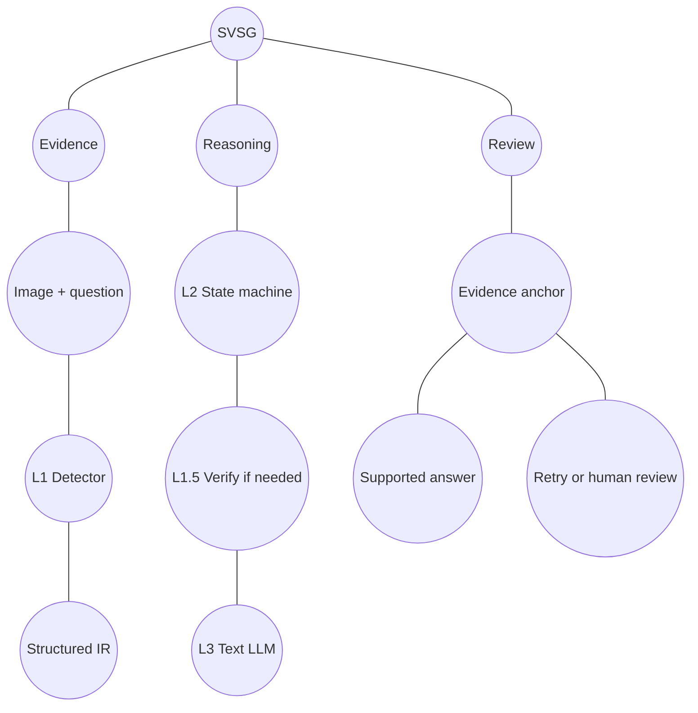

# SVSG — Structured Visual Semantic Gateway

**A structured visual-semantic gateway that grounds LLM reasoning in detector evidence rather than opaque visual interpretation.** [中文文档](README.zh.md)

## The Problem

A conventional pipeline sends an image directly to a VLM such as GPT-4V or Claude Vision and accepts its description. That visual interpretation can be unstable:

- Ask about the same image twice and the answers can contradict each other
- Counting is often wrong ("the image has 3 apples" when there are actually 5)
- Spatial relationships are described vaguely ("the cup on the left" — which one is that exactly)

## SVSG's Approach

**SVSG first compiles the image into a structured intermediate representation (IR) with a detector, then gives that evidence to an LLM for reasoning.**

```
Conventional:  Image → VLM (black box) → Answer (unreliable)
SVSG:          Image → YOLO detection → IR (classes/positions/counts/relations) → LLM (white-box reasoning) → Answer (auditable)
```

The LLM doesn't need to "see" the image — it only needs to understand the structured detection results. Every conclusion can be traced back to concrete detection evidence.

## Quick Start

```bash
pip install -e ".[api,llm]"    # base service
python -m svsg                 # start (default 127.0.0.1:3002)
```

```bash
# Upload an image + ask a question
curl -X POST http://127.0.0.1:3002/v1/analyze-image \
  -F "image=@photo.jpg" \
  -F "question=How many red objects are in the image?"
```

## Two Core Capabilities

### 1. Separate visual detection from language reasoning

A detector such as YOLO performs visual recognition; the LLM reasons only over the resulting structured evidence. This separation makes each stage explicit and independently inspectable.

### 2. Evidence-anchored review

Every LLM output is anchored back to the detection evidence in the IR. Fabricated or unsupported claims are automatically rejected.

## Architecture



**What changes:** the detector produces inspectable evidence first; the LLM reasons over that evidence, and the runtime checks its structured claims before delivery. Unresolved cases can require human review. The natural-language claim coverage check currently logs a warning; it does not guarantee that every sentence is grounded.

| Layer | Responsibility |
|---|---|
| L1 | Detector adapter (YOLO/stub) → geometric relations → IR |
| L1.5 | Visual verification (timeout isolation + silent degradation) |
| L2 | FSM state machine, intent routing, conflict resolution, evidence anchoring |
| L3 | LLM orchestration loop, dual-channel answers, anchor-triggered veto and regeneration |

## Comparison with Conventional VLM

| | Conventional VLM direct answer | SVSG |
|---|---|---|
| Counting | Often wrong | Pixel-level detection, precise |
| Spatial relations | Vague descriptions | Structured IR (left_of/right_of/contains) |
| Auditability | Can't be traced | Every conclusion anchored to detection evidence |
| Hallucination | High | Low (anchor verification auto-vetoes unsupported claims) |
| Cost | Every call hits the VLM (expensive) | Detect once, LLM only reads text (cheap) |

## Authentication

```bash
# Method 1: API Key
curl -H "X-API-Key: ***" ...

# Method 2: Bearer token (requires prior registration)
curl -H "Authorization: Bearer ***" ...
```

## Testing

```bash
python -m pytest -q    # 108 tests
```

## License

MIT
