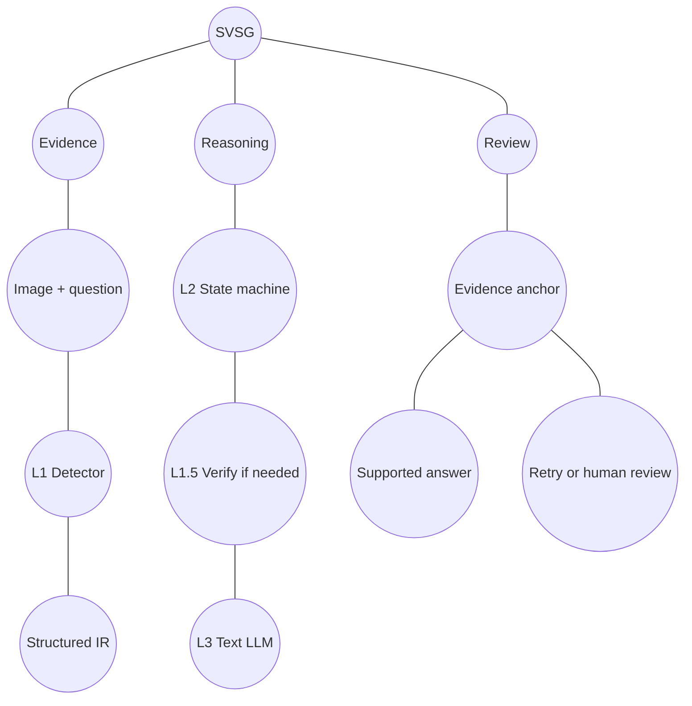

# SVSG — Structured Visual Semantic Gateway

**A structured visual-semantic gateway that grounds LLM reasoning in detector evidence rather than opaque visual interpretation.** [中文文档](README.zh.md)

## The Problem

A conventional pipeline sends an image directly to a VLM such as GPT-4V or Claude Vision and accepts its description. That visual interpretation can be unstable:

- Ask about the same image twice and the answers can contradict each other
- Counting is often wrong ("the image has 3 apples" when there are actually 5)
- Spatial relationships are described vaguely ("the cup on the left" — which one is that exactly)

## SVSG's Approach

**SVSG first compiles the image into a structured intermediate representation (IR) with a detector, then gives that evidence to an LLM for reasoning.**

```
Conventional:  Image → VLM (black box) → Answer (unreliable)
SVSG:          Image → YOLO detection → IR (classes/positions/counts/relations) → LLM (white-box reasoning) → Answer (auditable)
```

The LLM doesn't need to "see" the image — it reasons over structured detection results. Supported claims are checked against those results and any available verification evidence. This checks consistency with the evidence; it does not prove that the detector is correct.

## Quick Start

```bash
pip install -e ".[api,llm,ml]"
cp .env.example .env
# Edit .env: set your OpenAI-compatible endpoint, API key and model.
# Set SVSG_DETECTOR=yolo for real detection (weights may need downloading).
python -m svsg                 # default 127.0.0.1:3002
```

```bash
# Upload an image + ask a question
curl -X POST http://127.0.0.1:3002/v1/analyze-image \
  -F "file=@photo.jpg" \
  -F "query=How many objects were detected in the image?"
```

For development without a detector model, install `.[api,llm]` and use `SVSG_DETECTOR=stub`. The demo detector returns fixed example classes scaled to the image size; it does not recognize image contents. The default `SVSG_LLM_PROVIDER=stub` has no scripted answers and returns `aborted` for otherwise valid requests. Configure an LLM provider or inject a scripted `StubLLM` to obtain an answer.

The bundled L1.5 backend is also a stub. Requests requiring verification degrade to review when it has no results; real attribute verification requires a custom backend.

## Two Core Capabilities

### 1. Separate visual detection from language reasoning

A detector such as YOLO performs visual recognition; the LLM reasons only over the resulting structured evidence. This separation makes each stage explicit and independently inspectable.

### 2. Evidence-anchored review

Supported structured claims are anchored back to the IR and verification reports. Unknown fields, malformed values, missing instance references and conflicting evidence are rejected and enter the bounded regeneration/review flow. Natural-language `final_answer` is not fully semantically checked against `claims`; the current coverage warning is only a heuristic.

## Architecture



**What changes:** the detector produces inspectable evidence first; the LLM reasons over that evidence, and the runtime checks its structured claims before delivery. Unresolved cases can require human review. The natural-language claim coverage check currently logs a warning; it does not guarantee that every sentence is grounded.

| Layer | Responsibility |
|---|---|
| L1 | Detector adapter (YOLO/stub) → geometric relations → IR |
| L1.5 | Visual verification (timeout isolation + silent degradation) |
| L2 | FSM state machine, intent routing, conflict resolution, evidence anchoring |
| L3 | LLM orchestration loop, dual-channel answers, anchor-triggered veto and regeneration |

## Comparison with Conventional VLM

| | Conventional VLM direct answer | SVSG |
|---|---|---|
| Counting | Generated from visual interpretation | Checked against detected instances; missed/duplicate detections still affect accuracy |
| Spatial relations | Expressed in generated text | Recomputed from bounding boxes |
| Auditability | Depends on the model and application | Explicit IR, structured claims and validation outcomes |
| Unsupported claims | Depends on model behavior | Supported structured claims are validated; natural-language alignment remains incomplete |
| Cost | Depends on model and image usage | Detector inference plus text LLM calls; savings require workload measurement |

Nearest-neighbor claims use image-plane center distances and obey the IR scene gate. Camera intrinsics alone do not provide depth or physical scale. Numeric `relation:distance_to` claims are rejected until the claim schema can carry and validate a distance value and unit.

## Authentication

```bash
# API key mode: set SVSG_API_KEY; SVSG_AUTH_ENABLED remains false.
curl -H "X-API-Key: ***" ...

# Bearer mode: set SVSG_AUTH_ENABLED=1, then register and log in via /auth/*.
curl -H "Authorization: Bearer ***" ...
```

These modes are alternatives: enabling Bearer authentication replaces the API-key check. Without either setting, the API is unauthenticated and defaults to loopback. The first registered account becomes administrator; initialize it in a controlled environment. Registration remains open, and rate limiting is not implemented in the application.

## Testing

```bash
pip install -e ".[api,dev]"
python -m pytest -q
python -m ruff check svsg tests
python -m mypy svsg
```

## License

MIT
