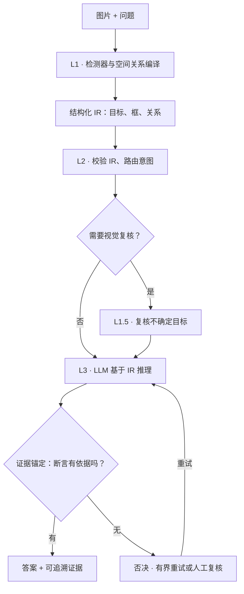

# SVSG — 结构化视觉语义网关

**让 LLM 看懂图片，但不靠 VLM 的模糊视觉。**

## 问题

传统方案是把图片扔给 GPT-4V / Claude Vision，让它"看图说话"。但 VLM 的视觉感知不稳定：

- 同一张图问两次，答案可能矛盾
- 计数经常出错（"图里有 3 个苹果"实际有 5 个）
- 空间关系判断模糊（"左边的杯子"到底是哪个）

## SVSG 的解法

**先用检测器把图片翻译成结构化的 IR（中间表示），再把 IR 喂给 LLM 推理。**

```
传统：  图片 → VLM（黑盒）→ 答案（不可靠）
SVSG：  图片 → YOLO 检测 → IR（类别/位置/数量/关系）→ LLM（白盒推理）→ 答案（可审计）
```

LLM 不需要"看"图，只需要读懂结构化的检测结果。每条结论都能追溯到具体的检测证据。

## 快速开始

```bash
pip install -e ".[api,llm]"    # 基础服务
python -m svsg                 # 启动（默认 127.0.0.1:3002）
```

```bash
# 上传图片 + 提问
curl -X POST http://127.0.0.1:3002/v1/analyze-image \
  -F "image=@photo.jpg" \
  -F "question=图里有几个红色的物体？"
```

## 两个核心能力

### 1. 给 LLM 配上准确的 VLM 眼镜

精确的检测器（YOLO）负责"看"，LLM 只负责"推理"。分工明确，各取所长。

### 2. 证据锚定审核

LLM 的每条输出都会被锚定到 IR 中的检测证据。编造或无依据的断言会被自动否决。

## 架构



**一眼看效果：**先由检测器给出可检查的证据，再由 LLM 推理，最后核对结构化断言；无法解决的冲突可交给人工复核。目前自然语言断言覆盖率只记录告警，并不保证答案的每句话都已锚定。

| 层 | 职责 |
|---|---|
| L1 | 检测器适配（YOLO/stub）→ 几何关系 → IR |
| L1.5 | 视觉验证（超时隔离 + 静默降级） |
| L2 | FSM 状态机、意图路由、冲突解决、证据锚定 |
| L3 | LLM 编排循环、双通道答案、锚定否决重生成 |

## 与传统 VLM 对比

| | 传统 VLM 直答 | SVSG |
|---|---|---|
| 计数 | 经常出错 | 像素级检测，精确 |
| 空间关系 | 模糊描述 | 结构化 IR（left_of/right_of/contains） |
| 可审计 | 无法追溯 | 每条结论锚定到检测证据 |
| 幻觉 | 高 | 低（锚定校验自动否决） |
| 成本 | 每次调 VLM（贵） | 检测一次，LLM 只读文本（便宜） |

## 鉴权

```bash
# 方式 1：API Key
curl -H "X-API-Key: your-key" ...

# 方式 2：Bearer 令牌（需先注册）
curl -H "Authorization: Bearer your-token" ...
```

## 测试

```bash
python -m pytest -q    # 108 个测试
```

## 许可证

MIT
