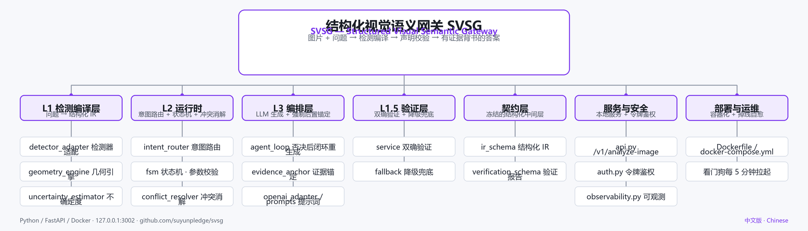
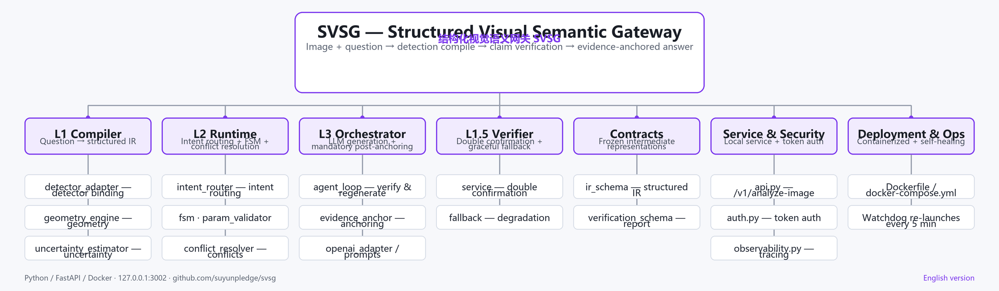

# 项目结构图谱 / Project Tree Map

当前仓库已合并 SVSG 与 MotionSpec。下方两张图片描述原有 SVSG 分层；最新目录见本节及
[单仓库说明](monorepo.md)。

```text
SVSG + MotionSpec
├── svsg/                         图像识别、函数编译和共享视频函数
├── packages/motionspec/
│   ├── motionspec/               视频分析与 CLI
│   ├── tests/                    视频及跨项目测试
│   └── tools/                    控制视频和复算验证
├── tests/                        图像与服务测试
├── docs/                         共用协议与评测记录
├── scripts/                      服务启动与评测入口
└── requirements-dev.txt          两个包的统一开发安装入口
```





## 中文

```text
结构化视觉语义网关 SVSG
├── L1 检测编译层 Compiler ── 问题 → 结构化 IR（l1_compiler/）
├── L2 运行时 Runtime ── 意图路由 + 状态机 + 冲突消解（l2_runtime/）
├── L3 编排层 Orchestrator ── LLM 生成 + 强制后置锚定（l3_orchestrator/）
├── L1.5 验证层 Verifier ── 双确验证 + 降级兜底（l15_verifier/）
├── 契约层 Contracts ── 冻结的结构化 IR 与验证 schema（contracts/）
├── 服务与安全 Service & Security ── api.py · auth.py · observability.py
└── 部署与运维 Deployment & Ops ── Dockerfile · docker-compose.yml · 看门狗掉线自愈
```

## English

```text
SVSG — Structured Visual Semantic Gateway
├── L1 Compiler ── question → structured IR (l1_compiler/)
├── L2 Runtime ── intent routing + FSM + conflict resolution (l2_runtime/)
├── L3 Orchestrator ── LLM generation + mandatory post-anchoring (l3_orchestrator/)
├── L1.5 Verifier ── double confirmation + graceful fallback (l15_verifier/)
├── Contracts ── frozen IR and verification schemas (contracts/)
├── Service & Security ── api.py · auth.py · observability.py
└── Deployment & Ops ── Dockerfile · docker-compose.yml · self-healing watchdog
```

> 图片保留原有分层说明，单仓库目录以本文顶部及根 README 为准。
