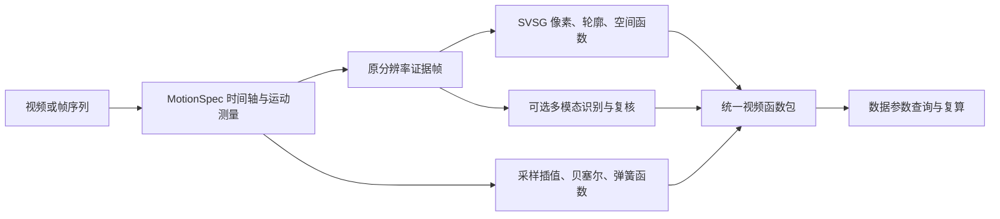

# SVSG 与 MotionSpec 的统一函数表达

`svsg.video-functions/1` 将视频证据组织为逐帧函数、帧间差分、时间函数与可选的物体观察。
实现位于 SVSG，MotionSpec 适配入口位于同仓库的 `packages/motionspec`。两个包分别安装，
复用编译器和求值器；SVSG 不导入 MotionSpec，MotionSpec 仅在请求函数导出时导入 SVSG。



## 数学语义

| 层 | 表达 | 精确范围 |
|---|---|---|
| 图像 | `F_i(x,y) = RGBA8` | 已导出的第 i 帧，沿用 `svsg.raster/1` |
| 几何 | `svsg.functions/1` | 沿用图像的区域、轮廓、颜色、空间关系，量化网格仍有独立尺寸 |
| 帧差 | `D_ij(x,y) = F_j(x,y) - F_i(x,y)` | 两个保留帧对应 RGBA 通道的有符号差，范围 -255..255 |
| 时间采样 | `v(t)=v_a(1-w)+v_b*w`, `w=(t-a)/(b-a)` | 复现原采样值，点间是线性插值，不是新增观测 |
| 贝塞尔 | 先解 `Bx(u)=(t-start)/(end-start)`，再求 `By(u)` | 独立通道的拟合进度，保留超调与 RMSE |
| 弹簧 | `1-exp(-ζωs)[cos(ωd*s)+ζω/ωd*sin(ωd*s)]` | `s=(t-start)/1000` 秒，`ωd=ω√(1-ζ²)` |
| 语义 | 帧内 `observations` / `relations` | 沿用 SVSG 复核状态，不把运动片段 ID 当物体轨迹 ID |

像素坐标原点在左上角、框为左闭右开，图像尺寸始终为源解码尺寸。时间使用源毫秒时间轴，
保留 `container` 或 `index` 时钟标记，不根据名义 FPS 重新分配已有时间戳。

帧差会包含压缩波动、光照、摄像机运动或切镜，因此不能直接解释为某个物体的位移。
时间函数只能在各自片段的支持范围内求值，范围外报错；没有跨片段补轨迹或插值缺失图像。
MotionSpec 隐藏部分的外推、下界、低置信和截短标记继续保留在结果中。

## 导出和求值

从仓库根目录安装图像函数和视频包：

```bash
python -m pip install -e ".[functions]" -e "./packages/motionspec"
python -m motionspec analyze clip.mp4 -o out --functions --sequence-id clip-001 --evidence-every-ms 500
```

`--functions` 启用统一导出，旧的 `spec.json` 和原始 PNG 保留。`--evidence-every-ms` 在运动
关键帧之外增加周期采样，静止或没有检测到片段的区间也可采样。默认仍仅保留原有关键帧。
周期采样选实际存在的下一帧，不生成新画面。关闭原始帧或不提供输出目录时不能导出函数。

已有 MotionSpec 输出可直接转换，无需重新分析视频：

```bash
python -m motionspec functions out/spec.json -o functions --sequence-id clip-001
python -m motionspec query functions/functions.json query.json
```

`query.json` 的图像操作沿用 `pixel_rgba` / `mean_rgba`，增加帧索引：

```json
{"id":"p","op":"pixel_rgba","frame_index":10,"x":100,"y":80}
```

其他调用示例：

```json
{"id":"m","op":"mean_rgba","frame_index":10,"box":[0,0,100,80]}
```

```json
{"id":"d","op":"delta_rgba","before_frame":10,"after_frame":24,"x":100,"y":80}
```

```json
{"id":"x","op":"motion_value","segment_id":"s1","name":"x","t_ms":300,"mode":"sampled"}
```

```json
{"id":"e","op":"motion_value","segment_id":"s1","name":"translate.progress","t_ms":300,"mode":"fitted"}
```

帧索引、时间与函数名称须来自本次清单；示例值不保证存在。查询返回来源帧/哈希或采样支持
时间、`sample` / `interpolated` / `fit` 类型。接口只执行白名单数据操作，不执行字符串代码。

```python
from svsg.video_functions import VideoRuntime

runtime = VideoRuntime.load("out/functions.json")
first = runtime.bundle.frames[0]
rgba = runtime.pixel(first.frame_index, 0, 0)
# 可重建已导出帧的全部解码像素，或直接使用原有 RasterFunction.mean/pixel。
image = runtime.raster(first.frame_index).to_image()
```

## 文件和预算

- `functions.json`：时间轴、帧函数摘要、轮廓、差分统计、运动函数参数与来源。
- `raster-<文件SHA-256>.json`：沿用原有图像函数编码，另保留像素哈希；复杂图像使用压缩 RGBA 载荷。完整载荷留在
  本地求值，不建议把它当作自然语言提示词发给模型。相同解码像素复用同一个文件。
- `spec.json.function_evidence`：函数清单文件名、文件 SHA-256、sequence ID 和帧数。
  `source_spec_sha256` 对规范化源规格计算，排除 `function_evidence`，避免哈希自引用。

默认最多 64 个证据帧（可通过 `--function-max-frames` 或 `functions --max-frames` 提到 256）、
总计 64×1024² 源像素、单帧最多 16×1024² 像素。超过预算直接报错，不静默丢帧。
Python 的 `export_motion_spec(..., max_total_pixels=...)` 可显式调整总像素预算。
逐帧编译只保留前后两帧的原始像素；函数摘要有缓存，相同像素避免重复扫描。
导出先写临时目录，完成校验后发布内容寻址文件，最后替换函数清单。

## 接入现有识别流程

```python
from svsg.recognition.frames import frame_reference
from svsg.video_functions import attach_recognition

# bundle 为函数包；row 和 image 必须来自同一份 MotionSpec 证据。
ref = frame_reference(bundle.sequence_id, row, image)
result = await recognizer.recognize(image, frame=ref)
bundle = attach_recognition(bundle, result)
```

接入时校验 sequence ID、原始帧号、毫秒时间、图片文件哈希、解码像素哈希及尺寸。返回一个新
函数包，不修改输入。待复核候选和失败原因保留；这一步不会自动启动新的模型请求。
序列化后的 `functions.json` 可作为下游观察层；若替换文件，必须同步更新上层文件哈希引用。

## 验证记录（2026-11-16）

SVSG 189 项测试通过；MotionSpec 54 项测试通过。新测试覆盖非均匀时间轴、贝塞尔 x 逆解、
弹簧秒单位、RGB/透明度差分、无变化帧复用、错误哈希/帧引用、预算和原子发布。

`packages/motionspec/tools/validate_functions.py` 对 4 段 MPEG-4 压缩控制视频验证：共 28 个保留帧，
逐像素还原误差均为 0；470 个原运动采样值误差均为 0；24 组差分与直接像素计算一致。
33 个拟合求值与 MotionSpec 原求值器的最大差约 2.46e-6（贝塞尔数值求解方式不同）。
素材包括合成平移、弹簧，以及真实照片生成的受控平移和静止片段。照片片段不是自然视频
识别真值；上述成绩仅证明函数表示与接入正确，没有测量人物跟踪或动作识别准确率。
本轮没有调用付费模型。
