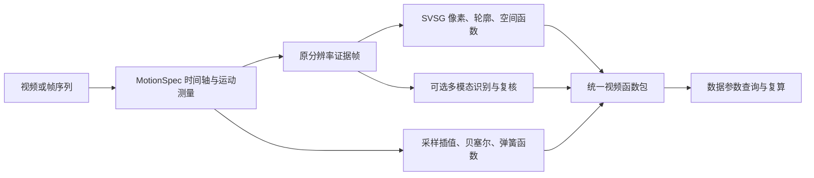

# SVSG 与 MotionSpec 的统一函数表达

`svsg.video-functions/1` 将视频证据组织为逐帧函数、帧间差分、时间函数与可选的物体观察。
实现位于 SVSG，MotionSpec 适配入口位于同仓库的 `packages/motionspec`。两个包分别安装，
复用编译器和求值器；SVSG 不导入 MotionSpec，MotionSpec 仅在请求函数导出时导入 SVSG。



## 数学语义

| 层 | 表达 | 精确范围 |
|---|---|---|
| 图像 | `F_i(x,y) = RGBA8` | 已导出的第 i 帧，沿用 `svsg.raster/1` |
| 几何 | `svsg.functions/1` | 沿用图像的区域、轮廓、颜色、空间关系，量化网格仍有独立尺寸 |
| 帧差 | `D_ij(x,y) = F_j(x,y) - F_i(x,y)` | 两个保留帧对应 RGBA 通道的有符号差，范围 -255..255 |
| 时间采样 | `v(t)=v_a(1-w)+v_b*w`, `w=(t-a)/(b-a)` | 复现原采样值，点间是线性插值，不是新增观测 |
| 贝塞尔 | 先解 `Bx(u)=(t-start)/(end-start)`，再求 `By(u)` | 独立通道的拟合进度，保留超调与 RMSE |
| 弹簧 | `1-exp(-ζωs)[cos(ωd*s)+ζω/ωd*sin(ωd*s)]` | `s=(t-start)/1000` 秒，`ωd=ω√(1-ζ²)` |
| 语义 | 帧内 `observations` / `relations` | 沿用 SVSG 复核状态，不把运动片段 ID 当物体轨迹 ID |

像素坐标原点在左上角、框为左闭右开，图像尺寸始终为源解码尺寸。时间使用源毫秒时间轴，
保留 `container` 或 `index` 时钟标记，不根据名义 FPS 重新分配已有时间戳。

帧差会包含压缩波动、光照、摄像机运动或切镜，因此不能直接解释为某个物体的位移。
时间函数只能在各自片段的支持范围内求值，范围外报错；没有跨片段补轨迹或插值缺失图像。
MotionSpec 隐藏部分的外推、下界、低置信和截短标记继续保留在结果中。

## 导出和求值

从仓库根目录安装图像函数和视频包：

```bash
python -m pip install -e ".[functions]" -e "./packages/motionspec"
python -m motionspec analyze clip.mp4 -o out --functions --sequence-id clip-001 --evidence-every-ms 500
```

`--functions` 启用统一导出，旧的 `spec.json` 和原始 PNG 保留。`--evidence-every-ms` 在运动
关键帧之外增加周期采样，静止或没有检测到片段的区间也可采样。默认仍仅保留原有关键帧。
周期采样选实际存在的下一帧，不生成新画面。关闭原始帧或不提供输出目录时不能导出函数。

已有 MotionSpec 输出可直接转换，无需重新分析视频：

```bash
python -m motionspec functions out/spec.json -o functions --sequence-id clip-001
python -m motionspec query functions/functions.json query.json
```

`query.json` 的图像操作沿用 `pixel_rgba` / `mean_rgba`，增加帧索引：

```json
{"id":"p","op":"pixel_rgba","frame_index":10,"x":100,"y":80}
```

其他调用示例：

```json
{"id":"m","op":"mean_rgba","frame_index":10,"box":[0,0,100,80]}
```

```json
{"id":"d","op":"delta_rgba","before_frame":10,"after_frame":24,"x":100,"y":80}
```

```json
{"id":"x","op":"motion_value","segment_id":"s1","name":"x","t_ms":300,"mode":"sampled"}
```

```json
{"id":"e","op":"motion_value","segment_id":"s1","name":"translate.progress","t_ms":300,"mode":"fitted"}
```

帧索引、时间与函数名称须来自本次清单；示例值不保证存在。查询返回来源帧/哈希或采样支持
时间、`sample` / `interpolated` / `fit` 类型。接口只执行白名单数据操作，不执行字符串代码。

```python
from svsg.video_functions import VideoRuntime

runtime = VideoRuntime.load("out/functions.json")
first = runtime.bundle.frames[0]
rgba = runtime.pixel(first.frame_index, 0, 0)
# 可重建已导出帧的全部解码像素，或直接使用原有 RasterFunction.mean/pixel。
image = runtime.raster(first.frame_index).to_image()
```

## 可见变化与估计设计时间（2026-11-17）

运动段新增可选的 `timing` 子协议 `svsg.motion-timing/1`，所有时间都使用源视频时钟、单位毫秒：

```json
{
  "version": "svsg.motion-timing/1",
  "unit": "ms",
  "clock": "source_timeline",
  "visible_change": {"t_start_ms": 325, "t_end_ms": 775, "duration_ms": 450},
  "estimated_design": {
    "t_start_ms": 250, "t_end_ms": 850, "duration_ms": 600,
    "easing": "in-out-cubic", "basis_t_start_ms": 325, "start_shift_ms": -75,
    "rmse": 0.01, "rmse_limit": 0.05,
    "provenance": "named_curve_alignment", "is_ground_truth": false
  },
  "design_unavailable_reason": null,
  "primary_channel": null,
  "channels": {}
}
```

- `visible_change` 描述检测到变化的时间支持范围，可能遗漏缓动头尾、透明或遮挡部分。
- `estimated_design` 根据命名曲线对齐估计设计起点与时长。复算关系为
  `t_start_ms = basis_t_start_ms + start_shift_ms`，`t_end_ms = t_start_ms + duration_ms`。
  `rmse` 是归一化进度的拟合误差，不是毫秒误差或统计置信区间。
- `channels` 为每个具有时序数据的通道提供相同的两套时间。`primary_channel` 指明片段采用哪个通道的
  设计估计；没有匹配通道时为空，起点基准来自片段本身。各通道可以有不同的设计时长。
- 片段截断、缺少命名拟合/对齐参数、拟合 RMSE 超过 0.05，或设计起点落在时钟零点之前时，
  `estimated_design=null`，原因写入 `design_unavailable_reason`。不能用可见时长冒充未知的设计时长。
- `motionspec.timing.motion_timing()` 是唯一的对齐计算入口。像素分析、Qt 轨迹、旧规格升级与文字摘要都使用它；
  SVSG 只校验并接收结果，不维护第二份拟合选择逻辑，也不反向依赖 MotionSpec。
- `MotionFunctions.t_start_ms/t_end_ms` 和 `samples/fits` 继续表示原有可见支持范围，保持已有求值行为。
  设计区间可以比它长，但不会扩大 `motion_value` 的可求值范围，也不会把外推估计变成观察样本。

正常 CLI 分析/导出会自动填充 `timing`。旧 `spec.json` 可通过现有 `motionspec functions` 命令升级；
它会先校验原始规格，再重算时间协议并更新内容哈希。直接调用 Python 编译器时可明确升级：

```python
from motionspec.timing import with_timing
from svsg.video_functions.temporal import compile_motion

enriched = with_timing(spec)  # 不修改输入规格
functions = [compile_motion(segment) for segment in enriched["segments"]]
```

新版运行时仍可读取没有 `timing` 的历史函数包。独立 SVSG 编译器收到旧片段时会保留可见区间，
并标记 `legacy_missing_timing`，不会猜测设计时长。旧版采用严格字段校验的消费者需升级后再读取新导出；
顶层视频协议版本暂保持 `/1`，新增子协议有自己的版本标识。

## 只查询 Qt 属性，无需录屏

```bash
motionspec trace trace.json -o probe
motionspec functions probe/spec.json -o probe/functions
motionspec query probe/functions/functions.json query.json
```

导出的 `svsg.probe-functions/1` 使用探针时钟和窗口设备像素坐标，不包含图像帧或差分。
例如，若清单中 `s1` 的颜色曲线覆盖 220 ms，可提交
`{"id":"alpha","op":"motion_value","segment_id":"s1","name":"color.a","t_ms":220}`。
四个颜色分量 `color.r/g/b/a`（查询需写完整名称，例如 `color.r`）取值 0 到 1；
`property.value` 保留自定义数值的原始单位和符号，属性名在 `reference.property_name`。
几何样本的 `width` 和 `height` 单位为源像素。只有实际保存了对应样本的片段才提供该函数。
从 Qt 几何轨迹新生成的片段还保留控件的旋转角 `rot_deg`，单位为度。
对采样时刻求值返回记录的角度，采样点之间的查询标记为 `interpolated`。
采样点间线性插值，区间外不外推。录制内的元素 ID 和同步组保存在每段的 `reference`；
同组元素仍可逐个查询。这些属性值不等于渲染后的像素颜色。

## 查询目录与批量查询（2026-11-18）

完整的 `functions.json` 每帧都带图像函数描述，一段动效就有一百多 KB。发查询之前先读目录：

```bash
python -m motionspec query functions/functions.json --list
```

目录只从清单里提取：每个片段的类型、置信度、区域、可见区间与设计时间，每个采样函数的单位、
时间支持、取值范围、节点数和来源，每个拟合函数的时间支持与 RMSE，以及可做像素查询的帧号和时间。
目录还列出坐标系、证据覆盖范围和片段的测量参照。对于 Qt 自定义属性，可用
`reference.element_id` 和 `reference.property_name` 找到要查询的控件和属性。
`visible_duration_ms` 表示可见时长，`design.duration_ms` 表示设计时长估计。
旧包缺少时间协议时，目录仍保留可见区间，并返回 `design: null` 和原因 `legacy_missing_timing`。
如果旧规格曾按宽度变化截短片段，使平移通道超出片段边界，需从源视频重新运行 `analyze` 才能取回遗漏区间的采样。
`query_examples` 根据当前清单中的帧号、函数名和有效时间生成，可以直接提交给 `query`。

参数文件可以是一个调用，也可以是至多 1000 个调用的列表。批量时逐个求值，某个调用出错
（例如参数不合法，或该帧的像素文件缺失）时，该项返回 `id` 和 `error`，同批的其余项继续求值。
函数清单本身无法读取或验证时，整次请求失败。

各条测量路径现在导出的采样函数：

| 路径 | 位置 `x/y` | 宽高 `width/height` | 透明度 `opacity` | 通道进度 `*.progress` |
|---|---|---|---|---|
| 跟踪 | 有（特征锚点） | 无（元素边界未知） | 无 | 有 |
| 图层（进入/退出） | 有（元素中心） | 有（亚像素外沿；框碰到分析窗口边时不给） | 有 | 有 |
| 多体（交错移动） | 有（点组中心） | 无 | 无 | 有 |
| 纯色块（变尺寸） | 有（框中心） | 有 | 无 | 有 |
| Qt 探针 | 有 | 有 | 有 | 有，另有 `color.*`、`property.value` |

用 `packages/motionspec/tools/function_accuracy.py` 可以把视觉路径导出的函数逐帧求值，和同一次渲染的
Qt 探针属性对比。第一批 6 个 Qt 场景上，位置误差最大 1.0 px，进入/退出元素的宽高误差最大 1.0 px，
透明度误差 0.0；第二批 9 个场景中能测的元素位置误差中位 0.5 px，进度条宽度误差最大 2.1 px。
布局重排（展开推动下方元素、侧栏收起）的位置函数仍会错到一百多像素，原因见 MotionSpec 的已知限制。

## 文件和预算

- `functions.json`：时间轴、帧函数摘要、轮廓、差分统计、运动函数参数与来源。
- `raster-<文件SHA-256>.json`：沿用原有图像函数编码，另保留像素哈希；复杂图像使用压缩 RGBA 载荷。完整载荷留在
  本地求值，不建议把它当作自然语言提示词发给模型。相同解码像素复用同一个文件。
- `spec.json.function_evidence`：函数清单文件名、文件 SHA-256、sequence ID 和帧数。
  `source_spec_sha256` 对规范化源规格计算，排除 `function_evidence`，避免哈希自引用。

默认最多 64 个证据帧（可通过 `--function-max-frames` 或 `functions --max-frames` 提到 256）、
总计 64×1024² 源像素、单帧最多 16×1024² 像素。超过预算直接报错，不静默丢帧。
Python 的 `export_motion_spec(..., max_total_pixels=...)` 可显式调整总像素预算。
逐帧编译只保留前后两帧的原始像素；函数摘要有缓存，相同像素避免重复扫描。
导出先写临时目录，完成校验后发布内容寻址文件，最后替换函数清单。

## 接入现有识别流程

```python
from svsg.recognition.frames import frame_reference
from svsg.video_functions import attach_recognition

# bundle 为函数包；row 和 image 必须来自同一份 MotionSpec 证据。
ref = frame_reference(bundle.sequence_id, row, image)
result = await recognizer.recognize(image, frame=ref)
bundle = attach_recognition(bundle, result)
```

接入时校验 sequence ID、原始帧号、毫秒时间、图片文件哈希、解码像素哈希及尺寸。返回一个新
函数包，不修改输入。待复核候选和失败原因保留；这一步不会自动启动新的模型请求。
序列化后的 `functions.json` 可作为下游观察层；若替换文件，必须同步更新上层文件哈希引用。

## 验证记录（2026-11-16）

SVSG 189 项测试通过；MotionSpec 54 项测试通过。新测试覆盖非均匀时间轴、贝塞尔 x 逆解、
弹簧秒单位、RGB/透明度差分、无变化帧复用、错误哈希/帧引用、预算和原子发布。

`packages/motionspec/tools/validate_functions.py` 对 4 段 MPEG-4 压缩控制视频验证：共 28 个保留帧，
逐像素还原误差均为 0；470 个原运动采样值误差均为 0；24 组差分与直接像素计算一致。
33 个拟合求值与 MotionSpec 原求值器的最大差约 2.46e-6（贝塞尔数值求解方式不同）。
素材包括合成平移、弹簧，以及真实照片生成的受控平移和静止片段。照片片段不是自然视频
识别真值；上述成绩仅证明函数表示与接入正确，没有测量人物跟踪或动作识别准确率。
本轮没有调用付费模型。
